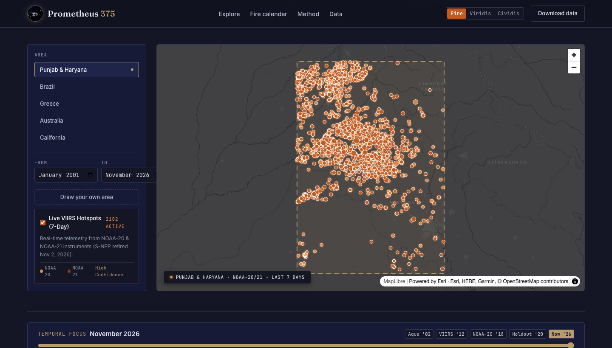
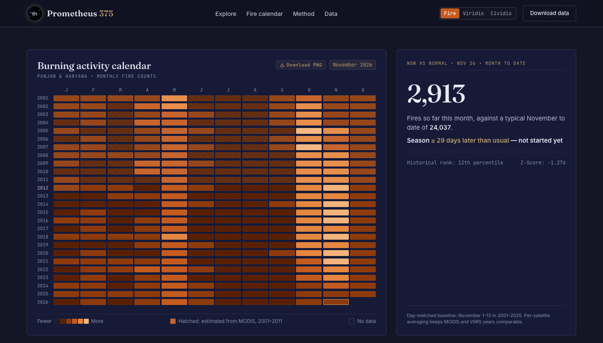

# Prometheus 375

**One consistent burning-activity calendar from 2001 to today, for any area on Earth, built by harmonizing NASA's MODIS and VIIRS active-fire hotspots so the satellite that saw a fire no longer matters.**

NASA Space Apps Challenge 2026 · Hyderabad · Challenge: *Harmonization of MODIS and VIIRS Hot Spots*

**Live app:** https://prometheus-375.vercel.app  
**Backend API:** `https://prometheus-375.onrender.com`: try [`/health`](https://prometheus-375.onrender.com/health), [`/presets`](https://prometheus-375.onrender.com/presets) or [`/validation`](https://prometheus-375.onrender.com/validation)





> The backend runs on Render's free tier. If the site has been idle, the first request can take about 30 seconds while it wakes up.

---

## The problem

Satellites have mapped active fires for more than 20 years, but the record is split across sensors that can't be compared directly:

| Sensor | Satellite | In orbit | Pixel |
|---|---|---|---|
| MODIS | Terra | Nov 2000 → | ~1 km |
| MODIS | Aqua | Jul 2002 → | ~1 km |
| VIIRS | S-NPP | Jan 2012 → **stopped delivering 2 Nov 2026** | 375 m |
| VIIRS | NOAA-20 | Apr 2018 → | 375 m |
| VIIRS | NOAA-21 | Mar 2023 → | 375 m |

VIIRS sees far more small fires than MODIS, and every time a satellite joins, raw totals jump. In Punjab & Haryana, raw yearly hotspot counts rise **+523%** from 2011 to 2012 and +103% from 2017 to 2018, just because VIIRS satellites joined. The harmonized series rises 12% and 11%. A fire manager who plots raw counts sees fake trends at 2002, 2012, 2018 and 2023. And because the MODIS satellites are near the end of their lives, the long history has to be carried forward onto VIIRS.

## What we built

A web app that turns 26 years of hotspots into one record on a single VIIRS scale, then lets anyone explore it:

- **Map:** pick a region preset (Punjab & Haryana, Brazil Pantanal, Greece, SE Australia, California), type a date range, or draw your own area.
- **Burning activity calendar:** years × months heatmap from 2001 to the current month. Cells estimated from MODIS (2001–2011) are hatched and show an uncertainty range. Three colour ramps: Fire, plus colour-blind-safe Viridis and Cividis.
- **Now vs normal:** this month's fire count against the same month in every earlier year (median, 10th–90th percentile, rank, z-score). For the current, unfinished month it compares the same days of the month (day-matched). It also shows whether the burning season started early or late.
- **Live hotspots:** the last 7 days of near-real-time VIIRS detections from NOAA-20 and NOAA-21.
- **Proof chart:** raw vs harmonized counts over time, so you can see the 2012 jump disappear.
- **Downloads:** hotspot CSV for your area and dates, monthly series + anomalies CSV, validation JSON, and PNGs of the calendar and chart.

## How it works

```
NASA FIRMS archive + NRT CSVs
  └─ pipeline/ (offline Python)
       01_clean      vegetation fires only (type 0); drop MODIS confidence < 30 and VIIRS "low";
                     drop archive/NRT overlap; mask static sources (gas flares, industry)
       02_grid       0.25° cells × month × satellite, with explicit zeros
       03_satfix     average per satellite within each family (never raw totals),
                     so a new satellite doesn't create a jump
       04_fit        MODIS → VIIRS ratio per 2.5° zone × month of year (Punjab+Haryana its own zone),
                     pooled over Feb 2012–Oct 2026 with 2020 held out; bootstrap 10–90% band = uncertainty
       05_series     one harmonized series: VIIRS where it exists, converted MODIS before it
       06_validate   test on 2020, a year the fit never saw
       07_anomaly    current vs same month of all prior years (day-matched for the current month)
       08_onset      burning-season start date and its shift vs earlier years
  └─ harmonized.parquet  (cell_id, lat, lon, month, harmonized_count, source, uncertainty)
       └─ backend/  FastAPI + DuckDB queries the parquet for any bbox or drawn polygon;
                    live hotspots from the FIRMS API (NOAA-20/21 only)
            └─ frontend/  React + Vite + TypeScript, MapLibre GL, terra-draw, Recharts
```

**Validation (2020 held out, never seen by the fit):** we converted 2020 MODIS to the VIIRS scale and compared it with what VIIRS actually saw. Errors are for monthly totals; MAPE counts only months with at least 10 fires.

| Area (2020, monthly totals) | Zone × month ratios | One ratio for the whole region |
|---|---|---|
| India | **11.4%** MAPE (bias +0.9%) | 24.8% |
| Punjab & Haryana | **20.8%** | 75.6% |
| Brazil | 7.9% | 19.7% |
| SE Australia | 9.4% | 13.3% |
| California | 15.6% | 30.8% |
| Greece | 26.6% | 24.4% |

Zones help everywhere except Greece, which has too few fires per zone to fit them well. Smaller areas are noisier: for a single 2.5° zone, monthly MAPE is 35–53%.

**API endpoints** (each takes `bbox=minLon,minLat,maxLon,maxLat` or `polygon=<GeoJSON>`):
`/calendar?start&end` · `/anomaly?month` · `/live?days=7` · `/export.csv?start&end` · `/export_analytics.csv` · `/presets` · `/validation` · `/health`

## Limitations

- **2001–2011 values are estimates.** Before VIIRS existed, counts are MODIS converted to the VIIRS scale, with an uncertainty band (hatched cells, ± range in tooltips and CSVs). They show patterns and anomalies well; treat single-month values as approximate.
- **Five archive regions.** Historical data was downloaded and processed for the five preset regions. Drawn areas outside them return "No fires in this area".
- **Live feed is 7 days**, NOAA-20 and NOAA-21 only (S-NPP stopped on 2 Nov 2026). Outside India, the archive's VIIRS is S-NPP only, so the latest month there is partly converted MODIS.
- **The current month is partial** and is compared day-for-day with earlier years, not with full months.
- **Area size:** drawn areas are limited to about twice California's size to keep the free server responsive. Drawn-area queries take about 10 s; presets are faster.
- **Hotspots are not burned area.** Counts depend on overpass times, clouds and smoke. Small or short fires can be missed by both sensors.

## Run it locally

Requirements: Python 3.11+, Node 20+.

```bash
# 1. Environment (never commit .env)
cp .env.example .env
#    FIRMS_MAP_KEY=   your NASA FIRMS key (optional: without it /live serves a bundled snapshot)
#    PARQUET_PATH=    path to harmonized.parquet (defaults to data/processed/ or backend/data/)

# 2. Backend → http://localhost:8000
cd backend
python -m venv .venv && source .venv/bin/activate
pip install -r requirements.txt
uvicorn main:app --reload --port 8000

# 3. Frontend → http://localhost:5173
cd ../frontend
cp .env.example .env        # VITE_API_URL=http://localhost:8000  (leave empty to use built-in sample data)
npm install
npm run dev
```

To rebuild the data from scratch, download FIRMS archive CSVs for each region into a folder outside the repo, then run `pipeline/01_clean.py` … `08_onset.py` in order (`pip install -r pipeline/requirements.txt`; each script's `--help` lists its options).

## Repo layout

| Folder | What |
|---|---|
| `pipeline/` | Offline Python: clean → grid → per-satellite averaging → MODIS→VIIRS fit → series → validate → anomalies → onset |
| `backend/` | FastAPI + DuckDB API over the harmonized parquet; live FIRMS feed; deploy notes in `backend/DEPLOYMENT.md` |
| `frontend/` | React + Vite + TypeScript web app (MapLibre GL, terra-draw, Recharts) |
| `data-sample/` | Small sample files in the data contract format |
| `docs/` | Team process: `AGENTS.md`, roles, `TASKS.md`, `DECISIONS.md` (every method decision with its reason), handoffs |

## Data sources and credits

- **NASA FIRMS** (Fire Information for Resource Management System), NASA Earthdata / LANCE: https://firms.modaps.eosdis.nasa.gov
  - MODIS Collection 6.1 active fires (Terra, Aqua): https://www.earthdata.nasa.gov/data/instruments/modis
  - VIIRS 375 m active fires (S-NPP, NOAA-20, NOAA-21): https://www.earthdata.nasa.gov/data/instruments/viirs
  - FIRMS API for near-real-time VIIRS (NOAA-20/21): https://firms.modaps.eosdis.nasa.gov/api/
- **Basemap:** Esri World Dark Gray Canvas (Esri, HERE, Garmin, © OpenStreetMap contributors), rendered with MapLibre GL JS.
- **Open-source libraries:** FastAPI, DuckDB, pandas, NumPy, Shapely, httpx (backend/pipeline); React, Vite, MapLibre GL JS, terra-draw, Recharts (frontend).
- **Photos:** the decorative photos in `frontend/public/images/` are placeholders being replaced with public-domain NASA imagery before judging; see `frontend/public/images/CREDITS.md`.

We acknowledge the use of data and imagery from NASA's Fire Information for Resource Management System (FIRMS), part of NASA's Earth Science Data and Information System (ESDIS).

## Team

| Member | Role |
|---|---|
| Sai Rishitha Chikoti | Data pipeline lead (clean, grid, per-satellite fix, MODIS→VIIRS fit, validation); frontend charts |
| Poojitha Arigela | Data analysis (series, validation, anomalies, season onset); `/anomaly` endpoint; slides |
| Karthik Yerra | Backend lead (FastAPI + DuckDB); repo owner; Render and Vercel deploys |
| Snehitha Neelakanti | Frontend lead (map, drawing, calendar, cards, live layer, accessibility, polish); demo video |

## Use of AI

Space Apps asks teams to state where AI tools were used.

- **Code:** we used AI coding assistants, mainly Claude (Claude Code), to draft and debug code in the pipeline, backend and frontend, write tests, and draft documentation, including this README. Every change was reviewed and tested by a team member. Commits where an assistant contributed carry a `Co-Authored-By` line in the git history; `AGENTS.md` is the shared instruction file we gave the tools.
- **Not AI:** the challenge choice, the harmonization method (per-satellite averaging, zone × month ratios, the 2020 holdout), and all data decisions were made by the team and are logged with reasons in `docs/DECISIONS.md`. The data is NASA FIRMS data processed by our own scripts; no data was generated by AI.
- **Images:** no AI-generated images, video or audio are used.

## License

MIT, see [LICENSE](LICENSE). Fire data: NASA FIRMS.
